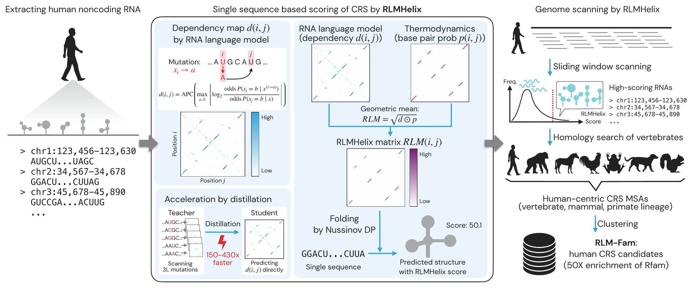

# RLMHelix

Alignment-free discovery of conserved RNA structures from single sequences.



Comparative searches for conserved RNA structures align homologous sequences first and look for structures
afterwards. RLMHelix reverses this order. It proposes structures in single sequences from the base–base dependencies
learned by an RNA language model (RiNALMo-giga), combined with thermodynamic base-pair probabilities, and only then
builds alignments for the candidates.

- **Dependency map.** Each position of a sequence is replaced by the three other nucleotides, and the dependency
  d(i, j) is the largest change in the language model's predicted log odds at position j, corrected by APC.
- **Distillation.** A small student head predicts the dependency map in one forward pass. For a 200-nt window the
  whole score, including the DP, is 147 times faster than with the 3L + 1 passes of the substitution scan, so that the
  transcribed human genome (about 7.9 million windows) can be scanned in about two GPU-days.
- **RLMHelix score.** Pair weights are the geometric mean of the dependency and the RNAfold base-pair probability,
  √(d · p). A Nussinov dynamic programme picks the non-crossing structure of largest total weight, and the score is
  the total weight of its stems of at least four base pairs.
- **Calibration.** A model of the shuffle score distribution as a function of length and composition turns scores into
  P values for genome scanning.
- **RLMHelix-MSA.** The same score for alignments, from dependencies averaged over the aligned sequences.

This repository contains the code and the trained models of RLMHelix, and documents the RLM-Fam catalogue of candidate
conserved RNA structures in the human genome, described in:

> Shunsuke Sumi, Shungo Adachi, Hirohide Saito and Michiaki Hamada. Alignment-free discovery of conserved RNA
> structures in the human genome. Manuscript submitted (2026).

**Status:** version 0.1.0, the public code release of the paper. The package scores sequences and alignments and
runs the pipelines of the paper: the genome scan (`rlmhelix scan`), candidate selection (`rlmhelix select`) and the
catalogue with its evidence tiers (`rlmhelix catalogue`). Each step was checked against the stored outputs of the
paper (see [Pipelines of the paper](#pipelines-of-the-paper)).

**Data.** The RLM-Fam catalogue (candidate table, alignments, covariance models, provisional families) and the
per-window results of the genome scan will be deposited on Zenodo (DOI to be added; public upon publication of the
paper). This repository holds no catalogue files; `catalogue/README.md` describes them and how to regenerate them.

## Installation

```bash
git clone https://github.com/Shunsuke-1994/rlmhelix.git
cd rlmhelix
conda env create -f environments/environment.yml   # or, in a Python ≥ 3.11 venv: pip install -e ".[test]"
conda activate rlmhelix
pytest -m "not model"                                # about 1 min; `pytest -m model` needs the language model
```

Python ≥ 3.11. Dependencies: PyTorch, transformers and multimolecule (RiNALMo-giga is downloaded from Hugging Face on
first use, about 2.6 GB), ViennaRNA (Python bindings), numba, NumPy, SciPy, pandas, joblib and pyarrow. The
language-model stack is pinned (`transformers>=5.5,<5.6`, `multimolecule==0.0.9`) because newer multimolecule and
transformers releases fail to run RiNALMo-giga or change the scores, and RiNALMo-giga is loaded at the Hugging Face
revision used for the paper (`2a71f6f`). Reading Supplementary Table S8 as .xlsx with
`scripts/download_data.py --encode-table` or `rlmhelix catalogue build --eclip` also needs openpyxl, which is in the
conda environment and in the `data` extra (`pip install -e ".[test,data]"`). A GPU is recommended; on the CPU the
language model runs in float32 and is slow.
`environments/environment.yml` lists the versions used for the paper; both routes were tested on 2026-10-11
(`environments/README.md`).

## Quick start

Score single sequences (30–300 nt) and alignments from the command line:

```bash
rlmhelix score sequences.fa -o scores.tsv                  # score, calibrated P value, scored stems, structure
rlmhelix score sequences.fa --shuffles 100 -o scores.tsv   # also z and empirical P against the sequence's own shuffles
rlmhelix msa family.sto -o msa.tsv                         # RLMHelix-MSA, dependency-only, BPP-only, RNAalifold −MFE
```

`examples/` scores four known human RNAs (tRNA, let-7 precursor, U2 snRNA, U3 snoRNA) and shows the expected output.
From Python:

```python
from rlmhelix import Student, Calibrator, rlmhelix_score

student = Student()                                  # RiNALMo-giga + distilled head
apc = student.predict([sequence])[0]                 # APC-corrected dependency map (L × L)
result = rlmhelix_score(apc, sequence)               # result.score, result.structure
p = Calibrator.load().pvalues([result.score], [sequence])[0]
```

**Which P value to use.** The calibrated P value was built for the 200-nt windows of the genome scan and is
anti-conservative for short sequences (30–99 nt). To judge a single RNA, compare its score with those of its own
dinucleotide-preserving shuffles (`--shuffles`), as the benchmarks of the paper do. The calibrated P value is 0 when a
score lies above the upper end of the fitted null distribution.

**Alignments** are read from Stockholm files. The reference sequence (for example human) must be the first row; it is
always kept when the alignment is pruned to six sequences. Without a `#=GC RF` line, the columns where the first row
has a residue are scored.

## What the package computes

| Module | Content |
|---|---|
| `rlmhelix.student` | Student head and batched inference on the frozen backbone |
| `rlmhelix.score` | RNAfold base-pair probabilities, W = √(max(d, 0) · p), non-crossing Nussinov DP (AU, GC, GU; loops ≥ 3), removal of isolated pairs, sum over stems of ≥ 4 pairs |
| `rlmhelix.calibrate` | Conditional GEV calibration (25 length and composition features) and P values |
| `rlmhelix.msa` | RNAz-style pruning to six sequences, column-averaged dependencies, RNAalifold base-pair probabilities, maximum over 200-column windows (step 100) |
| `rlmhelix.shuffle` | Dinucleotide-preserving shuffles (Altschul–Erickson) |
| `rlmhelix.dependency` | Teacher dependency maps (3L + 1 forward passes, maximum over directions) and APC, for reproducing the training targets |
| `rlmhelix.scan` | Genome scan: window placement, repeat filters, batched scoring, calibrated P values, Benjamini–Hochberg, empirical-null local FDR |
| `rlmhelix.select` | Candidate selection: structural cores of the top 1% of windows, homology search (Riboseek) and the four routes, covariance-model alignments across 55 vertebrates (Infernal), provisional families |
| `rlmhelix.catalogue` | Candidate statistics from the scan, icSHAPE agreement, covariation (R-scape), evidence tiers and the catalogue tables |

## Pipelines of the paper

The genome-wide analysis of the paper runs as three pipelines, each a sub-command of `rlmhelix`. The public inputs
are downloaded with `scripts/download_data.py` (`data/README.md`), and the external programs are listed in
`environments/README.md`.

```bash
# 1. Genome scan (docs/pipeline_scan.md): 7,869,821 windows of 200 nt over GENCODE v50 introns, UTRs and lncRNAs
rlmhelix scan prepare --gtf gencode.v50.annotation.gtf.gz --genome GRCh38.primary_assembly.genome.fa \
    --rmsk rmsk.txt.gz -o scan/windows                       # CPU, tantan and IRF; about 30 min
rlmhelix scan score --windows scan/windows -o scan/scores    # one GPU, about 2 days
rlmhelix scan fdr --scores scan/scores -o scan               # BH, loci, empirical null and lfdr; under 1 min

# 2. Candidate selection (docs/pipeline_select.md): top 1% of windows -> 71,196 cores -> 15,913 selected ->
#    15,821 candidates with alignments of up to 55 vertebrates -> 14,037 provisional families
rlmhelix select cores scan/eligible_windows.parquet -o select/cores    # GPU
rlmhelix select chunk ... ; rlmhelix select search ... ; rlmhelix select routes ...   # Riboseek, 20 vertebrates
rlmhelix select seed ... ; rlmhelix select expand ...                  # Infernal, 55 vertebrates
rlmhelix select families ...                                            # RLMFam00001, RLMFam00002, ...

# 3. Catalogue (catalogue/README.md): lfdr, icSHAPE agreement, covariation and evidence tiers
rlmhelix catalogue candidates select/expand/candidates.parquet --families select/families/families.tsv \
    -o candidates.tsv                                                   # candidate table of the catalogue steps
rlmhelix catalogue icshape ... ; rlmhelix catalogue covariation ... ; rlmhelix catalogue build ...
```

Each step was checked against the stored outputs of the paper. The scan reproduces the 7,869,821 windows, the 565
Benjamini–Hochberg windows (481 loci) and the empirical null. The pure-Python steps of the selection reproduce the
loci, cores, routes, alignments and families from the paper's stored search and Infernal outputs (the homology
searches were not repeated, and Infernal was rerun end to end for three small candidates), and the catalogue
reproduces the local false discovery rates and the evidence tiers of all 15,821 candidates. The steps that depend on
the language model match the paper on a GPU with full batches of 16 (the default), except for a few windows per
chromosome and a few cores near the thresholds (see Reproducibility). The full chain takes several days on one GPU
and a multi-core CPU (run times of each step are in the documentation); `reproduce/README.md` lists, for each figure
and table, the commands and data that regenerate it, and the analyses that are not included in this repository.

## Reproducibility

On a GPU with bf16 autocast and batches of 16 sequences (the defaults), single-sequence scores and calibrated P values
equal those of the paper's genome scan, and RLMHelix-MSA scores equal those of the Rfam benchmark to about 10⁻⁶.
Other batch sizes change the bf16 rounding of the language model and shift scores by about 0.1%. Two exceptions
come from how the paper's runs were batched: at most 15 windows per chromosome, which the paper scored in a shorter
last batch, can differ by about 0.1% (`docs/pipeline_scan.md`, Reproducibility), and a few cores near the
stem-length or pairing thresholds can differ in a fresh `select cores` run (`docs/pipeline_select.md`, Notes on
reproducing the paper exactly). The backbone is loaded from Hugging Face at the revision used for the paper,
`multimolecule/rinalmo-giga` at `2a71f6f98fb41dd2e6542a5e131d3778111d1468` (`rlmhelix.dependency.BACKBONE_REVISION`,
also importable from `rlmhelix.student`); `Student(revision=None)` loads the latest revision instead. `tests/`
checks these values on a few scan windows and one Rfam alignment (`pytest`; the model tests need a GPU).

## Contents

| Path | What it holds |
|---|---|
| `src/rlmhelix/` | The Python package and its models (`models/`) |
| `examples/` | Four known RNAs with the expected output |
| `tests/` | Tests against values of the paper |
| `scripts/` | `download_data.py`, which downloads the public data of the pipelines |
| `data/` | Public data used, where to obtain them, and the panel of 55 vertebrate genomes (`genome_panel_55.tsv`, also shipped with the package) |
| `catalogue/` | Documentation of the RLM-Fam catalogue files (to be deposited on Zenodo; no data files here): column definitions and how to regenerate them |
| `reproduce/` | Which commands and data reproduce each figure and table of the paper |
| `environments/` | Software environment |
| `docs/` | Detailed documentation of the pipelines (`pipeline_scan.md`, `pipeline_select.md`) and figures for this README |

## Citation

If you use RLMHelix or RLM-Fam, please cite the paper above (see also `CITATION.cff`). Please also cite RiNALMo, whose
weights the student builds on, and ViennaRNA, which computes the base-pair probabilities.

## References

Methods that the package implements or depends on:

- Penić, R. J. et al. RiNALMo: general-purpose RNA language models can generalize well on structure prediction tasks.
  *Nat. Commun.* **16**, 5671 (2025). https://doi.org/10.1038/s41467-025-60872-5
- Tomaz da Silva, P. et al. Nucleotide dependency analysis of genomic language models detects functional elements.
  *Nat. Genet.* **57**, 2589–2602 (2025). https://doi.org/10.1038/s41588-025-02347-3
- Dunn, S. D., Wahl, L. M. & Gloor, G. B. Mutual information without the influence of phylogeny or entropy
  dramatically improves residue contact prediction. *Bioinformatics* **24**, 333–340 (2008).
  https://doi.org/10.1093/bioinformatics/btm604
- Lorenz, R. et al. ViennaRNA Package 2.0. *Algorithms Mol. Biol.* **6**, 26 (2011).
  https://doi.org/10.1186/1748-7188-6-26
- McCaskill, J. S. The equilibrium partition function and base pair binding probabilities for RNA secondary
  structure. *Biopolymers* **29**, 1105–1119 (1990). https://doi.org/10.1002/bip.360290621
- Nussinov, R. & Jacobson, A. B. Fast algorithm for predicting the secondary structure of single-stranded RNA.
  *Proc. Natl Acad. Sci. USA* **77**, 6309–6313 (1980). https://doi.org/10.1073/pnas.77.11.6309
- Bernhart, S. H. et al. RNAalifold: improved consensus structure prediction for RNA alignments.
  *BMC Bioinformatics* **9**, 474 (2008). https://doi.org/10.1186/1471-2105-9-474
- Washietl, S., Hofacker, I. L. & Stadler, P. F. Fast and reliable prediction of noncoding RNAs.
  *Proc. Natl Acad. Sci. USA* **102**, 2454–2459 (2005). https://doi.org/10.1073/pnas.0409169102 (alignment pruning)
- Altschul, S. F. & Erickson, B. W. Significance of nucleotide sequence alignments: a method for random sequence
  permutation that preserves dinucleotide and codon usage. *Mol. Biol. Evol.* **2**, 526–538 (1985).
  https://doi.org/10.1093/oxfordjournals.molbev.a040370
- Kandel, D., Matias, Y., Unger, R. & Winkler, P. Shuffling biological sequences. *Discrete Appl. Math.* **71**,
  171–185 (1996). https://doi.org/10.1016/S0166-218X(97)81456-4
- Jiang, M. et al. uShuffle: a useful tool for shuffling biological sequences while preserving the k-let counts.
  *BMC Bioinformatics* **9**, 192 (2008). https://doi.org/10.1186/1471-2105-9-192

## License

The code is released under the MIT License (see `LICENSE`). The RNA language model weights and external tools are not
redistributed and keep their own licenses. The example and test sequences come from Rfam (CC0) and the human genome
(GRCh38).
